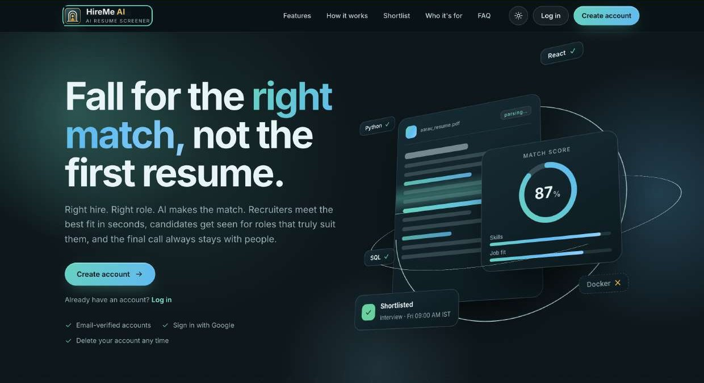
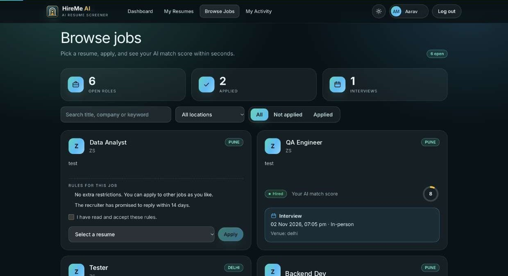
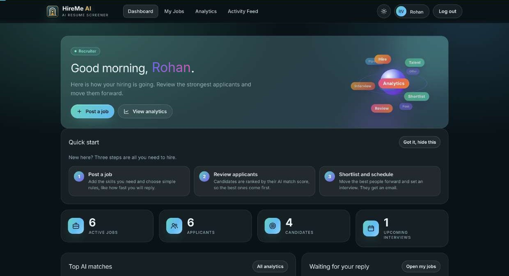
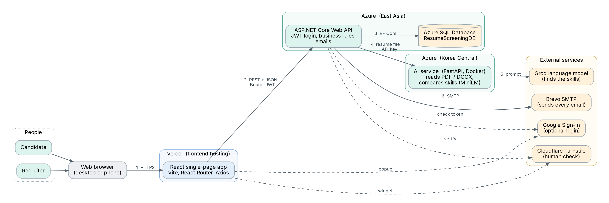

<p align="center">
  <picture>
    <source media="(prefers-color-scheme: dark)" srcset="Frontend/public/hireme-logo-dark.svg">
    
  </picture>
</p>

<p align="center"><b>Right hire. Right role. AI makes the match.</b><br>AI-assisted resume screening for recruiters and candidates.</p>

<p align="center">
  <a href="https://hireme-ai-hiring.vercel.app">Live website</a> ·
  <a href="docs/HireMe-AI-Documentation.pdf">Documentation (PDF)</a> ·
  <a href="DEPLOYMENT.md">Deployment</a> ·
  <a href="SECURITY.md">Security</a>
</p>

## What it does

HireMe AI is a hiring website with two sides. **Candidates** upload a resume once and apply to jobs. **Recruiters** post jobs and get
every applicant already ranked by an AI match score. The AI reads each resume, finds the skills in it, compares them with the skills
the job asks for, and gives a score from 0 to 100. The score supports a decision, it never makes one: people always decide.

<p align="center"></p>

## Features

**For candidates**

- Create an account with an emailed one-time code, or sign in with Google.
- Upload PDF or DOCX resumes. The AI extracts the skills and keeps them on the profile.
- Browse and search jobs, read the rules of each job and accept them before applying.
- Apply with a chosen resume and see the AI match score straight away.
- Follow every application: status, interview date, time, mode and venue, and a full activity trail.
- Edit the profile, change the password or delete the account, each protected by an emailed code.

**For recruiters**

- Post jobs with the skills that matter and four application rules: one job at a time, a pause after a hire,
  a wait after a rejection, and a promised reply time.
- See the applicants of each job ranked by match score, with the matched skills.
- Shortlist, reject or hire, and schedule interviews. The candidate gets an email every time.
- A dashboard with the best matches, the people still waiting for a reply, and upcoming interviews.
- Analytics: skill distribution, candidate status, applications over time, interview pipeline.

**For everyone**

- Branded HTML emails with a plain-text copy, light and dark theme, mobile friendly pages, search engine basics
  (titles, sitemap, robots), and a consent record for the Terms and the Privacy Policy.

<p align="center">
  
  
</p>

## How the match score works

| Part | How it is calculated |
| --- | --- |
| Skill match | A language model lists the skills in the resume and in the job. Each skill becomes a vector (MiniLM embeddings). A job skill counts as matched when its closest resume skill is at least 0.60 similar. Skill match = matched job skills / all job skills x 100. |
| Job fit | The whole resume text and the whole job text become vectors. Their cosine similarity x 100. |
| Final score | 50% skill match + 50% job fit. |

## Architecture

<p align="center"></p>

| Part | Technology |
| --- | --- |
| Website | React, Vite, React Router, Axios, Tailwind CSS, Recharts |
| API | ASP.NET Core (.NET 10), Entity Framework Core, JWT sign-in, MailKit |
| Database | Microsoft SQL Server (Azure SQL in production), EF Core migrations |
| AI service | Python 3.12, FastAPI, sentence-transformers (all-MiniLM-L6-v2), pdfplumber, python-docx, a Groq language model |
| Services | Cloudflare Turnstile (human check), Google Sign-In, Brevo (email) |
| Delivery | GitHub Actions (tests, backend deploy), Vercel (website), Azure (API, database, AI service) |

## Repository layout

```
BackendAPI/          the web layer: controllers, start-up and settings
BackendAPI.Core/     models, repositories, services, migrations (all the business rules)
BackendAPI.Tests/    xUnit tests
Frontend/            the React website and its tests
AiService/           the FastAPI service that reads resumes and scores matches
SQL_server/          schema and helper scripts
Postman/             a collection to try the API
scripts/             helper scripts (warm up the free-tier services before a demo)
docs/                the documentation and its pictures
.github/workflows/   automatic tests and backend deployment
```

## Run it locally

You need the .NET 10 SDK, Node.js 22, Python 3.12 and Docker.

**1. Database**

```bash
docker run -e "ACCEPT_EULA=Y" -e "MSSQL_SA_PASSWORD=<choose-a-strong-password>" -p 1433:1433 --name sqlserver -d mcr.microsoft.com/mssql/server:2022-latest
```

The API creates the database and applies the migrations when it starts.

**2. AI service**

```bash
cd AiService
python3 -m venv venv && source venv/bin/activate
pip install -r requirements.txt
export GROQ_API_KEY=<your-groq-key>
export AI_SERVICE_KEY=<a-shared-secret-of-your-choice>
uvicorn main:app --port 8000
```

`GROQ_MODEL` is optional (the default is `openai/gpt-oss-20b`).

**3. API**

```bash
cd BackendAPI
export ConnectionStrings__DefaultConnection="Server=localhost,1433;Database=ResumeScreeningDB;User Id=sa;Password=<the-password-from-step-1>;TrustServerCertificate=True"
export Jwt__Key=<a-random-secret-of-at-least-32-characters>
export Jwt__Issuer=hireme-ai
export Jwt__Audience=hireme-ai
export AiService__BaseUrl=http://localhost:8000
export AiService__ApiKey=<the-same-secret-as-AI_SERVICE_KEY>
dotnet run
```

The API listens on `http://localhost:5140`. Optional settings: `GoogleAuth__ClientId` (Google sign-in), `Turnstile__SecretKey`
(for local work use Cloudflare's public test keys, which always pass), and `SmtpSettings__Host`, `__Username`, `__Password`,
`__FromEmail` (to send real emails; without them an email is skipped and the error is only logged).

**4. Website**

```bash
cd Frontend
cp .env.example .env.local
npm install
npm run dev
```

Open `http://localhost:5173`.

## Tests

```bash
dotnet test BackendAPI.Tests        # backend
cd Frontend && npm test             # website
```

Both run automatically on every pull request. There are more than 250 automatic tests, including tests that check the wording of the
legal pages, the e-mail templates, the job rules and that no secret or personal detail is committed.

## CI/CD

- **CI** runs the backend and the website tests, and the website build, on every push and pull request.
- **Deploy backend** publishes the API to Azure App Service when backend code changes on `main`.
- The website is deployed by Vercel on every merge to `main`.

See [DEPLOYMENT.md](DEPLOYMENT.md) for where things run and the names of the settings.

## Security

Passwords are stored as hashes, every API call checks the sign-in token, a person can only read or change their own data, and no secret
lives in the code. See [SECURITY.md](SECURITY.md) to report a problem.

## Documentation

The full documentation (architecture, database, the match score, every flow, every screen for candidates and recruiters, the API and the
emails) is in [docs/HireMe-AI-Documentation.pdf](docs/HireMe-AI-Documentation.pdf).

## License

All rights reserved. See [LICENSE](LICENSE).

## Contact

workbuildwithus@gmail.com
